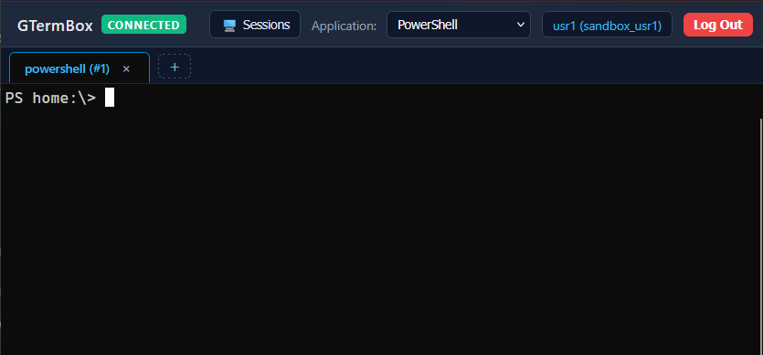

# GTermBox – Sandboxed WebTerminal

GTermBox is a secure web terminal gateway that streams native Windows console applications (such as PowerShell, Python TUI, and command-line editors) directly into modern web browsers over HTTP/3 WebTransport.



---

## Key Features

*   **Transport & Networking:**
    *   **WebTransport / HTTP/3 (QUIC RFC 9220):** Bidirectional streaming via `msquic.dll` and `ls-qpack.dll`. Hardware-accelerated TLS 1.3 AEAD, zero-polling I/O.
    *   **HTTPS (SChannel SSPI):** Native Windows TLS 1.3/1.2 stack, zero OpenSSL dependency.
    *   **Mutual TLS (mTLS / Client Certificates):** Optional zero-trust hardware/client cryptographic verification (`disabled`, `optional`, `required`) with Root CA validation and SHA-256 direct trust pinning.
    *   **W3C Cert Fingerprinting:** Automated SHA-256 hash negotiation (`/api/certificate-hash`, W3C Section 3.3).
*   **Sandbox & Isolation:**
    *   **Windows AppContainer (`smStandard`):** Restricted SID tokens; isolated filesystem, registry, and network namespaces.
    *   **Capability SIDs:** Granular outbound networking (`S-1-15-3-1` Internet, `S-1-15-3-3` Private LAN).
    *   **DACL Management:** Dynamic directory inheritance (`allowedDirs` RX, `allowedDirsWrite` RW).
    *   **Windows Job Object:** Hard memory limit (512 MB commit), CPU throttling, recursive `JOB_OBJECT_LIMIT_KILL_ON_JOB_CLOSE`.
    *   **Admin Mode (`smJobOnly`):** Unrestricted filesystem access with Job Object quota enforcement.
*   **Security & RBAC:**
    *   **Zero-Trust mTLS Authentication:** Seamless passwordless cryptographic login via `POST /api/login/mtls` for verified client certificates, issuing claims with `mtls_authenticated: true`.
    *   **JWT Authentication:** HMAC-SHA256 Bearer tokens carrying identity, role, and grant claims.
    *   **Role Enforcement:** `admin` vs `user` app filtering; HTTP 403 on unauthorized launch.
    *   **Session Management:** Live introspection (`GET /api/admin/sessions`) and termination (`POST /api/admin/sessions/kill`).
*   **Web Client (xterm.js):**
    *   **Multi-Session Engine:** Independent concurrent tabs via `TabManager`.
    *   **Terminal Emulation:** 24-bit TrueColor, VT100/VT220, native clipboard paste.
    *   **Control Sequences:** Passthrough for `Ctrl+O` (0x0F), `Ctrl+S` (0x13), `Ctrl+P` (0x10).
    *   **File Transfer:** Drag-and-drop upload to sandbox; direct download via `/api/sandbox/file`.

---

## Requirements & Dependencies

Detailed system requirements, Delphi compiler versions (Win64), native binaries (`msquic.dll`, `ls-qpack.dll`), and core framework dependencies (`QuickLib`, `QuickLogger`, `FastMM5`, `GHttpsIOCPSvr`) are documented in [GHttpsIOCPSvr Requirements & Dependencies](https://github.com/gecko-71/GHttpsIOCPSvr/blob/main/README.md).

---

## Frontend Dependencies: web/lib/

Client files are bundled in `web/lib/` by default:
*   `xterm.js` (v5.5.0)
*   `xterm.css` (v5.5.0)
*   `addon-fit.js` (v0.10.0)

To re-download or update them via PowerShell:
```powershell
New-Item -ItemType Directory -Force -Path "web\lib"
Invoke-WebRequest -Uri "https://cdn.jsdelivr.net/npm/@xterm/xterm@5.5.0/lib/xterm.js" -OutFile "web\lib\xterm.js"
Invoke-WebRequest -Uri "https://cdn.jsdelivr.net/npm/@xterm/xterm@5.5.0/css/xterm.css" -OutFile "web\lib\xterm.css"
Invoke-WebRequest -Uri "https://cdn.jsdelivr.net/npm/@xterm/addon-fit@0.10.0/lib/addon-fit.js" -OutFile "web\lib\addon-fit.js"
```

---

## Getting Started: Running the Server

### 1. SSL/TLS Certificate for WebTransport
Follow the W3C certificate generation guide in [GHttpsIOCPSvr Certificate Management](https://github.com/gecko-71/GHttpsIOCPSvr/blob/main/README.md) (run `.\gen_w3c_wt_cert.ps1` as Administrator).
* **14-Day Validity Window:** In accordance with the W3C WebTransport specification, certificates paired with `serverCertificateHashes` must not exceed a validity period of 14 days. The script generates an ECDSA P-256 certificate strictly adhering to this standard.
* **Startup Expiration Guard:** `GTermBoxServer` performs an automated cryptographic validity check at launch using `CertVerifyTimeValidity`. If the certificate in the specified store is expired or missing, the server halts immediately with exit code `1` and emits a critical error message advising generation of a fresh certificate.

### 2. Build the Project
Open and compile `GTermBoxServer.dproj` (or `GTermBoxServer.dpr`) and `ManageUsers.dproj` (or `ManageUsers.dpr`) in RAD Studio / Delphi for **Win64 Debug** or **Win64 Release**. Both projects are bundled together in `GTermBoxtGroup.groupproj`.

### 3. Provision the Environment (`Install-GTermBox.ps1`)
Run `Install-GTermBox.ps1` from an elevated PowerShell window (Run as Administrator) to perform full automated setup, W3C WebTransport certificate generation, firewall rule configuration, and an automated self-test:
```powershell
# Standard installation (auto-detects local network IP):
.\Install-GTermBox.ps1

# Or bind to a specific network adapter and port:
.\Install-GTermBox.ps1 -BindIp 198.51.100.11 -Port 8443
```
Once installed, start the server using `.\Start-GTermBox.cmd` (or `.\Start-GTermBoxServer.bat`).

### 4. Launch the Server
Run `Win64\Debug\GTermBoxServer.exe`.

The server will initialize and listen on:
*   **HTTPS / WebTransport:** `https://localhost:8443`

### 5. Mutual TLS (mTLS) Authentication (Optional)
GTermBox provides optional hardware/client certificate verification based on the Traefik client authentication pattern (`NoClientCert`, `VerifyClientCertIfGiven`, `RequireAndVerifyClientCert`), natively powered by Windows Schannel SSPI:

| CLI Switch Value | Traefik Equivalent | Behavior |
| :--- | :--- | :--- |
| `--mtls disabled` | `NoClientCert` | **Default.** Standard TLS server. Anonymous connections without client certificates are permitted. |
| `--mtls optional` | `VerifyClientCertIfGiven` | **Hybrid mode.** Server requests a client certificate. If presented, the certificate is validated against the trusted whitelist or CA chain; if omitted, standard anonymous access (e.g. username/password login) is permitted. |
| `--mtls required` | `RequireAndVerifyClientCert` | **Strict Zero-Trust.** Server mandates a valid, non-expired client certificate present on the Out-of-Band whitelist (`trusted_clients/`), signed by the trusted Root CA, or matching `--mtls-pinned`. Connections without a certificate or with untrusted/expired certificates are terminated immediately at the TLS handshake level (`PerformGracefulSSLShutdown`). |

#### Dual Verification Models:
1. **Out-of-Band Direct Trust Whitelist (Recommended for Air-Gapped & Offline Nodes):**
   * Eliminates the single point of failure and private key sharing of central Root CAs.
   * Clients generate independent self-signed keys locally (`usr1.key` + `usr1.crt`, `admin.key` + `admin.crt`).
   * Only the public certificates (`.crt` / `.cer`) are transferred (e.g. via USB flash drive) into the server's `trusted_clients\` directory.
   * The server automatically parses `trusted_clients\` at launch, hashes all certificates with SHA-256, and maps thumbprints to user identities in memory.
2. **Hierarchical PKI (Root CA Chain):**
   * Uses `--ca-cert <path>` to validate client certificates signed by an enterprise or custom Root CA.

#### Command-Line Parameters:
*   `--mtls <disabled|optional|required>` — Configures client certificate verification policy.
*   `--trusted-clients <dir>` — Directory containing trusted client public certificates (defaults automatically to `trusted_clients\` inside the server directory).
*   `--ca-cert <path>` (or `--cacert`, `--capath`) — Path to the trusted Root CA certificate (`.crt` or `.pem`).
*   `--mtls-pinned <sha256_hex>` — Restricts client authentication to a specific SHA-256 certificate thumbprint (Direct Trust Pinning).

#### Zero-Trust Cryptographic Login & Identity Protection:
*   `GET /api/mtls/status` — Returns mTLS state of the current connection, including client subject, CommonName, issuer, SHA-256 thumbprint, validity dates, and `whitelisted_user`.
*   `POST /api/login/mtls` — Authenticates the user cryptographically via their verified client certificate without requiring a password, issuing a standard JWT Bearer token with the claim `"mtls_authenticated": true` and appropriate role/permissions.
*   **Identity Mismatch Protection:** If a client establishes an mTLS connection with `usr1.crt` and attempts to submit a form login targeting the `admin` account, the server rejects the request with **HTTP 403 Forbidden** (`"mTLS certificate mismatch"`).
*   **Multiple Administrator Accounts:** Any account in `users.json` with `"role": "admin"` or administrative grants receives full admin capabilities when authenticating with their assigned client certificate.

#### File Manager Full Disk Access for Administrators:
*   **Administrator Mode:** When authenticated as an admin (`role: admin`), the File Manager defaults to or allows navigation to `scope=drives`, listing all logical disk drives (`C:\`, `D:\`, ...) with `isDrivesRoot: true`. Navigating into `C:\` sets `parentPath: "drives"`, and clicking the `🖴 Drives` or `⬆ Up` button returns directly to the drive list.
*   **Standard User Confinement:** Regular users (`role: user`) are strictly confined to their private sandbox (`home:\`). Any attempt to query `scope=drives` or `scope=server` is denied with **HTTP 403 Forbidden**.

#### Web Browser Setup & Troubleshooting:

##### 1. Google Chrome & Microsoft Edge:
*   **WebTransport Trust (Fixes *"Not Secure"* & WebTransport Connection Errors):**
    Chromium requires the server certificate (`localhost.cer`) to be trusted in the Windows Root store for HTTP/3 WebTransport (UDP/QUIC) to function. Run:
    ```cmd
    .\Win64\Debug\Install-ServerCertificate.cmd
    ```
    Click **Yes** on the Windows Security Warning dialog. This adds `localhost.cer` to `Cert:\CurrentUser\Root`, turning the URL bar lock green and enabling WebTransport.
*   **Client Certificate Installation:**
    Import the user's client certificate into the Windows Personal store:
    ```cmd
    .\Win64\Debug\Install-ClientCertificate.cmd admin
    ```
    *(or for a regular user: `Install-ClientCertificate.cmd usr1`)*.
*   **Switching or Clearing Remembered Client Certificates:**
    Chrome caches the chosen client certificate per TLS session. To switch users or force Chrome to prompt again:
    1. Press `Win + R`, type `inetcpl.cpl`, and press **Enter**.
    2. Go to the **Content** tab.
    3. Click **Clear SSL state**.
    4. Alternatively, open a new **Incognito Window** (`Ctrl + Shift + N`) to be prompted immediately.

##### 2. Mozilla Firefox:
*   Firefox maintains an isolated certificate store (NSS) independent of the Windows system store.
*   To enable Firefox to use Windows client certificates automatically:
    1. Type `about:config` into the Firefox address bar.
    2. Search for `security.osclientcerts.autoload` and toggle it to **`true`**.
*   Alternatively, import `admin.pfx` directly via *Settings -> Privacy & Security -> Certificates -> View Certificates -> Your Certificates -> Import* (Password: `PasswordAdmin!`).

#### CLI Execution Examples:
```powershell
# Launch in strict Zero-Trust mTLS mode with Out-of-Band whitelist:
.\Win64\Debug\GTermBoxServer.exe --port 8443 --mtls required

# Launch in strict mTLS mode with Root CA:
.\Win64\Debug\GTermBoxServer.exe --port 8443 --mtls required --ca-cert test_certs\test_root_ca.crt

# Launch with Direct Trust Pinning for a specific client certificate:
.\Win64\Debug\GTermBoxServer.exe --port 8443 --mtls required --mtls-pinned "4D64D505D41FA52B06F0F2BD1E954EE32857D0CD704F78CF9696C8E6490F4F24"

# Launch in hybrid optional mode:
.\Win64\Debug\GTermBoxServer.exe --port 8443 --mtls optional
```

---

## Application Binaries & Environments: Far, Edit, and PyTui

GTermBox comes pre-configured to stream Far Manager, Microsoft Edit, and a Python Demo TUI. Follow the instructions below to download pre-built binaries, build from source, or set up virtual environments.

### 1. Far Manager (`Win64\Debug\Far\Far.exe`)

*   **Option A: Download Pre-built Binaries (Recommended):**
    1. Download the latest 64-bit portable archive (`Far30b*.x64.*.7z` or `.zip`) from [Far Manager Official Downloads](https://www.farmanager.com/download.php) or [FarGroup GitHub Releases](https://github.com/FarGroup/FarManager/releases).
    2. Alternatively, install via WinGet:
       ```powershell
       winget install FarGroup.FarManager
       ```
    3. Extract/copy all files into `Win64\Debug\Far\` so that `Far.exe`, `FarEng.lng`, `lua51.dll`, `sqlite3.dll`, and `Plugins\` reside directly inside `Win64\Debug\Far\`.

*   **Option B: Build from Source:**
    1. Prerequisites: Visual Studio (MSVC C++ toolchain) and CMake.
    2. Clone the repository:
       ```cmd
       git clone https://github.com/FarGroup/FarManager.git
       cd FarManager
       ```
    3. Configure and build 64-bit release:
       ```cmd
       cmake -B build -A x64
       cmake --build build --config Release
       ```
    4. Copy the generated files from `build\bin\` into `Win64\Debug\Far\`.

---

### 2. Microsoft Edit (`Win64\Debug\Edit\edit.exe`)

*   **Option A: Download Pre-built Binary (Recommended):**
    1. Download the latest `edit.exe` Windows binary from [Microsoft Edit GitHub Releases](https://github.com/microsoft/edit/releases/latest).
    2. Alternatively, install via WinGet:
       ```powershell
       winget install Microsoft.Edit
       ```
    3. Place `edit.exe` into `Win64\Debug\Edit\edit.exe`.

*   **Option B: Build from Source:**
    1. Prerequisites: Rust toolchain installed via [rustup.rs](https://rustup.rs/).
    2. Clone the repository (or navigate to `MsEdit\edit` in the workspace):
       ```cmd
       git clone https://github.com/microsoft/edit.git MsEdit\edit
       cd MsEdit\edit
       ```
    3. Compile using Cargo (Release mode):
       ```cmd
       cargo build --release
       ```
       *(Optional: To optimize binary size, run `set RUSTC_BOOTSTRAP=1` followed by `cargo build --release --config .cargo/release.toml`)*.
    4. Copy the compiled binary `target\release\edit.exe` to `Win64\Debug\Edit\edit.exe`.

---

### 3. Python Demo TUI (`Win64\Debug\PyTui\`) & Virtual Environment

The Python TUI demo runs through a batch wrapper (`run.cmd`) that sets the active console code page to UTF-8 (`@chcp 65001 >nul`) and launches Python using a local virtual environment:

1. **Prerequisites:** Python 3.10+ installed on the host system and available on your `PATH`.
2. **Setup Virtual Environment:**
   From the repository root, create the virtual environment in `Win64\Debug\PyTui\venv`:
   ```powershell
   python -m venv Win64\Debug\PyTui\venv
   ```
   *(Or navigate into `Win64\Debug\PyTui` and run `python -m venv venv`)*.
3. **Directory Structure:**
   The `Win64\Debug\PyTui` folder should contain:
   ```text
   Win64\Debug\PyTui\
   ├── app.py                     # Python TUI application script
   ├── run.cmd                    # ConPTY launch wrapper (@chcp 65001 + venv\Scripts\python.exe)
   └── venv\                      # Local virtual environment
       └── Scripts\
           └── python.exe         # Isolated Python runtime
   ```
4. **Custom Dependencies:**
   If you extend `app.py` or add new scripts requiring third-party pip packages (e.g. `rich`, `textual`), install them directly into this virtual environment:
   ```cmd
   Win64\Debug\PyTui\venv\Scripts\pip.exe install <package_name>
   ```

---

## Configuration Architecture

### 1. Default Credentials & Authentication
Authentication is stateless and managed via HTTP POST `/api/login`:
*   **Password Verification:** Verified against individual cryptographic salts using SHA-256:
    $$\text{passwordHash} = \text{SHA-256}(\text{salt} + \text{":"} + \text{password})$$
    When the lowercase hex digest matches `passwordHash`, the server issues a cryptographically signed JWT Bearer token carrying user identity, role, sandbox path, client IP binding, and permitted applications.
*   **Token Verification:** Bearer tokens are validated on every REST API request and verified against client IP during the WebTransport QUIC handshake.
*   **Pre-configured Accounts & Hashing Walkthrough:**
    *   **`usr1`** (`role: "user"`, password: `1234`):
        *   `salt`: `"salt_usr1_8f2a1b9c3e"` (generated with high-entropy OS random bytes)
        *   `password`: `"1234"`
        *   Input to SHA-256: `"salt_usr1_8f2a1b9c3e:1234"`
        *   `passwordHash`: `"96e90211ce9ca78a7c3f2961ffc22fe4f7547f7172cdea6ec69ecaf3f37e51f1"`
        *   Standard unprivileged account restricted to AppContainer sandbox (`sandbox_usr1`) and standard apps (`far`, `edit`, `powershell`, `pytui`).
    *   **`admin`** (`role: "admin"`, password: `1234`):
        *   `salt`: `"salt_admin_7951d215c4"`
        *   `password`: `"1234"`
        *   Input to SHA-256: `"salt_admin_7951d215c4:1234"`
        *   `passwordHash`: `"ce20232d96aa0651ef8b56fb8abb831d83f2b17dabcb612a30075cb4d062bf57"`
        *   Full administrator account authorized for wildcard applications (`apps: ["*"]`), job-only administrative shells (`admin-powershell`), and session introspection (`/api/admin/*`).
*   **Cryptographic Properties:**
    *   **Rainbow Table Immunity:** Even though `admin` and `usr1` share the same default password (`1234`), their stored `passwordHash` values are completely different because each account possesses a unique cryptographic salt.
    *   **Automated Salt Rotation:** Changing a password via `ManageUsers passwd <user> <new_password>` automatically generates a fresh random salt, recalculating the hash and protecting against replay attacks.

---

### 2. `apps.json` — Application Profiles
Defines the registry of executable console applications streamed via ConPTY:

```json
{
  "apps": [
    {
      "id": "far",
      "name": "Far Manager",
      "command": "Far\\Far.exe",
      "args": [
        "-title:Far",
        "-s",
        "%SANDBOX%\\profile",
        "%SANDBOX%\\profile\\local",
        "%SANDBOX%",
        "%SANDBOX%"
      ],
      "env": ["TERM=xterm-256color", "COLORTERM=truecolor"],
      "cols": 160,
      "rows": 38,
      "sandbox": "standard",
      "roles": ["user", "admin"]
    },
    {
      "id": "edit",
      "name": "Microsoft Edit",
      "command": "Edit\\edit.exe",
      "args": [],
      "env": ["TERM=xterm-256color", "COLORTERM=truecolor"],
      "cols": 120,
      "rows": 40,
      "sandbox": "standard",
      "roles": ["user", "admin"]
    },
    {
      "id": "powershell",
      "name": "PowerShell",
      "command": "powershell.exe",
      "args": [
        "-NoExit",
        "-NoLogo",
        "-ExecutionPolicy",
        "Bypass"
      ],
      "env": ["TERM=xterm-256color", "COLORTERM=truecolor"],
      "cols": 120,
      "rows": 30,
      "sandbox": "job-only",
      "roles": ["user", "admin"]
    },
    {
      "id": "pytui",
      "name": "Python Demo TUI",
      "command": "PyTui\\run.cmd",
      "args": [],
      "env": [
        "TERM=xterm-256color",
        "COLORTERM=truecolor",
        "PYTHONIOENCODING=utf-8",
        "PYTHONUTF8=1"
      ],
      "cols": 120,
      "rows": 30,
      "sandbox": "job-only",
      "roles": ["user", "admin"]
    },
    {
      "id": "python",
      "name": "Python Console",
      "command": "python.exe",
      "args": [
        "-i"
      ],
      "env": [
        "TERM=xterm-256color",
        "COLORTERM=truecolor",
        "PYTHONIOENCODING=utf-8",
        "PYTHONUTF8=1"
      ],
      "cols": 120,
      "rows": 30,
      "sandbox": "job-only",
      "roles": ["user", "admin"]
    },
    {
      "id": "admin-powershell",
      "name": "PowerShell Administrator",
      "command": "powershell.exe",
      "args": [
        "-NoExit",
        "-NoLogo",
        "-ExecutionPolicy",
        "Bypass"
      ],
      "env": [
        "TERM=xterm-256color",
        "COLORTERM=truecolor"
      ],
      "cols": 120,
      "rows": 30,
      "sandbox": "job-only",
      "network": true,
      "allowedDirs": [],
      "allowedDirsWrite": [],
      "roles": [
        "admin"
      ]
    }
  ]
}
```

#### Parameter Reference (`apps.json`):
*   **`id`** *(string)*: Unique application identifier passed in session creation (`POST /api/terminal/session`).
*   **`name`** *(string)*: Display name rendered in the frontend application selector dropdown.
*   **`command`** *(string)*: Executable file path or script wrapper (relative to server root or absolute system path). Supports binary executables (`.exe`) as well as shell/batch scripts (`.cmd`, `.bat`).
*   **`args`** *(array of strings)*: Command-line arguments passed to the spawned process.
*   **`env`** *(array of strings)*: Environment variables injected into the process environment block (`KEY=VALUE`).
*   **`cols` / `rows`** *(integer)*: Default virtual pseudo-console screen buffer dimensions for ConPTY.
*   **`sandbox`** *(string)*: Process isolation mode:
    *   `"standard"` (`smStandard`): Windows AppContainer with restricted token SID and private directory isolation (used by standalone utilities like `Far.exe` and `edit.exe`).
    *   `"job-only"` (`smJobOnly`): Windows Job Object with RAM/CPU quota enforcement without AppContainer isolation (used for administrative shells like `admin-powershell` as well as CLI runtimes like `powershell.exe` and `python.exe`, which require host system CLR/.NET runtime libraries incompatible with un-packaged AppContainer tokens).
    *   `"none"` (`smNone`): Direct execution under the host server context.
*   **`network`** *(boolean, optional)*: Outbound network capability:
    *   `true`: Grants `S-1-15-3-1` (`WinCapabilityInternetClientSid`) and `S-1-15-3-3` (`WinCapabilityPrivateNetworkClientServerSid`).
    *   `false`: Completely blocks network capabilities at the Windows kernel level.
*   **`allowedDirs`** *(array of strings, optional)*: Directory paths dynamically granted read/execute DACL access (`GENERIC_READ | GENERIC_EXECUTE`) for the AppContainer SID.
*   **`allowedDirsWrite`** *(array of strings, optional)*: Directory paths dynamically granted full read/write DACL access (`GENERIC_ALL`) for the AppContainer SID.
*   **`roles`** *(array of strings, optional)*: RBAC roles authorized to enumerate and launch this application (`["user", "admin"]`). Defaults to `["admin", "user"]` if omitted.

#### Scripts and Batch Execution Wrappers (`.cmd`, `.bat`)
GTermBox ConPTY engine natively supports executing Windows batch scripts as application targets:
*   **Use Cases:** Script wrappers allow setting up virtual environments, configuring Windows code pages (such as `@chcp 65001 >nul` for UTF-8), or chaining startup commands prior to launching interactive TUIs (e.g. `PyTui\run.cmd`).
*   **Environment Injections:** Scripts can receive tailored environment variables declared in `apps.json` (such as `PYTHONIOENCODING=utf-8` and `PYTHONUTF8=1`) to guarantee lossless UTF-8 multibyte character, box-drawing, and emoji streaming across xterm.js.

#### Administrative Shell (`admin-powershell`) & Job-Only Sandbox
For administrative operations, GTermBox provides an elevated shell profile with specific security controls:
*   **Role Restriction:** Explicitly locked to `"roles": ["admin"]`. Standard users cannot view this profile in `/api/apps` or spawn it (enforced via HTTP 403 Forbidden).
*   **Job-Only Sandbox (`smJobOnly`):** Executes outside the restricted AppContainer security token, granting access to host system tools, directories, and management commands, while remaining governed by the Windows Job Object (enforcing strict memory quotas and clean, recursive process tree termination upon session disconnect).
*   **Network Access:** Outbound networking is enabled (`"network": true`) for remote management and administrative tasks.
*   **User Grants Verification:** Launching a `job-only` application requires the user account to have `allowJobOnly: true` (granted by default to `role: "admin"`).

---

### 3. `users.json` — RBAC & Sandbox Grants
Defines user identities, authentication hashes, and granular security overrides:

```json
{
  "users": [
    {
      "username": "usr1",
      "role": "user",
      "salt": "salt_usr1_8f2a1b9c3e",
      "passwordHash": "96e90211ce9ca78a7c3f2961ffc22fe4f7547f7172cdea6ec69ecaf3f37e51f1",
      "clientCertificate": "usr1.crt",
      "sandbox": "sandbox_usr1",
      "apps": ["far", "edit", "powershell", "pytui"]
    },
    {
      "username": "admin",
      "role": "admin",
      "salt": "salt_admin_7951d215c4",
      "passwordHash": "ce20232d96aa0651ef8b56fb8abb831d83f2b17dabcb612a30075cb4d062bf57",
      "clientCertificate": "admin.crt",
      "sandbox": "sandbox_admin",
      "apps": ["*"],
      "grants": {
        "network": true,
        "allowJobOnly": true,
        "fullDiskAccess": true,
        "allowedDirsRead": [],
        "allowedDirsWrite": []
      }
    }
  ]
}
```

#### Parameter Reference (`users.json`):
*   **`username`** *(string)*: Unique login identifier.
*   **`role`** *(string)*: Primary RBAC role (`"admin"` or `"user"`). Embedded as a claim into JWT tokens. Multiple administrator accounts can share `"role": "admin"`.
*   **`clientCertificate`** *(string, optional)*: Associated client certificate filename (e.g. `"admin.crt"`, `"usr1.crt"`) or SHA-256 thumbprint for seamless Zero-Trust mTLS authentication. Bound automatically by `Install-GTermBox.ps1` or manually via `ManageUsers.exe bind-cert`.
*   **`salt`** *(string)*: Cryptographic per-user salt in the format `salt_<username>_<random_hex>` generated with OS-level high-entropy randomness (`TGUID.NewGuid` in Delphi). Prevents rainbow table attacks and guarantees distinct hashes across users with identical passwords.
*   **`passwordHash`** *(string)*: 64-character lowercase hex digest of `SHA-256(salt + ":" + password)`. Computed natively by Delphi (`THashSHA2.GetHashString`).
*   **`sandbox`** *(string)*: Dedicated directory relative to server root assigned as process `Cwd` and granted exclusive read/write DACL permissions for the user's AppContainer profile.
*   **`apps`** *(array of strings)*: Whitelist of allowed application IDs. Supports wildcard `["*"]` to inherit all applications permitted by the user's role.
*   **`grants`** *(object, optional)*: Fine-grained security overrides evaluated during session establishment:
    *   **`network`** *(boolean)*: User-level network override. Effective network access is computed as `app.network AND user.grants.network`.
    *   **`allowJobOnly`** *(boolean)*: Authorizes execution of `sandbox: "job-only"` profiles (automatically true for `role: "admin"`).
    *   **`fullDiskAccess`** *(boolean)*: Grants bypass of restricted directory isolation.
    *   **`allowedDirsRead`** *(array of strings)*: Additional read-only directory paths merged with the application's `allowedDirs`.
    *   **`allowedDirsWrite`** *(array of strings)*: Additional write-enabled directory paths merged with the application's `allowedDirsWrite`.

---

### 4. User & Application Management Tool (`ManageUsers.dpr` / `ManageUsers.exe`)
GTermBox includes a dedicated, zero-dependency native Delphi console utility (`ManageUsers.dpr` / `ManageUsers.exe`) located in the root workspace alongside `GTermBoxServer.dpr` and compiled to `Win64\Debug\ManageUsers.exe`.

#### Operational Model
*   **Self-Contained & Native:** Executes natively on 64-bit Windows without requiring Python or external runtime dependencies. All configuration management takes place directly inside `ManageUsers.dpr` / `ManageUsers.exe`.
*   **Local File Discovery:** Reads and writes `users.json` and `apps.json` directly from the directory where the `.exe` resides (`ExtractFilePath(ParamStr(0))`). When deployed to `Win64\Debug\`, it operates on `Win64\Debug\users.json` and `Win64\Debug\apps.json`.
*   **Automatic Incremental Backups:** Before every file modification, it automatically creates a versioned backup (`users_v1.json`, `users_v2.json`, `apps_v1.json`, etc.).
*   **Physical Disk Cleanup on Deletion:**
    *   **User Deletion (`delete`):** Verifies that the sandbox path is strictly within the server directory (canonical path validation preventing directory traversal attacks), and recursively removes the entire user sandbox folder (`sandbox_<username>`) from disk in addition to removing the user entry from `users.json`.
    *   **Application Deletion (`delete-app`):** Removes the application entry from `apps.json`, deletes application shims (`<id>.cmd`) and app directories (`apps\<id>`) across all user sandboxes, deletes server-level `apps\<id>`, and performs a cascade update across `users.json` to prune the deleted application ID from every user's `apps` whitelist.
*   **Clean UTF-8:** Serializes JSON in pure UTF-8 without BOM (`0xEF, 0xBB, 0xBF`), ensuring seamless interoperability with web servers, external tools, and JSON parsers.

#### Usage Modes

##### 1. Interactive Menu Mode
Run `ManageUsers.exe` with no command-line arguments to launch the 13-item interactive console management menu:
```text
=== GTermBox Management Tool ===
--- User Management (users.json) ---
1. List users
2. Add new user
3. Edit user parameters (role, apps, sandbox, grants)
4. Change user password
5. Delete user
6. Show user details
--- Application Management (apps.json) ---
7. List applications
8. Add new application
9. Edit application parameters
10. Delete application
11. Show application details
12. Display help documentation
13. Initialize complete GTermBox environment
0. Exit

Select option [0-13]:
```

##### 2. Command-Line (CLI) Automation
For automated deployments, DevOps, and scripting, `ManageUsers.exe` supports full subcommand automation:

*   **User Management:**
    *   `ManageUsers list` — Display a formatted table of all registered users, roles, sandboxes, bound client certificates (`Cert`), and granted capabilities.
    *   `ManageUsers show <username>` — Display formatted JSON, security grants, and linked client certificate for a specific user.
    *   `ManageUsers bind-cert <username> <certfile>` — Bind a client certificate file (`.crt` from `trusted_clients\`) or SHA-256 thumbprint to a user for mTLS Zero-Trust authentication.
    *   `ManageUsers add <username> <password> [options]` — Create or update a user account. Options:
        *   `--role <admin|user>` (default: `user`)
        *   `--cert <filename_or_thumb>` (bind client certificate for mTLS)
        *   `--apps <app1,app2|*>` (comma-separated allowed apps or wildcard `*`)
        *   `--sandbox <dirname>` (custom sandbox directory, default: `sandbox_<username>`)
        *   `--no-network` (disable network access for AppContainer)
        *   `--allow-job-only` (authorize job-only administrative shells)
        *   `--dirs-read <dir1,dir2>` (extra read-only directory paths)
        *   `--dirs-write <dir1,dir2>` (extra read/write directory paths)
    *   `ManageUsers edit <username> [options]` — Modify an existing user's parameters and grants (`--role`, `--cert`, `--sandbox`, `--apps`, `--network`, `--no-network`, `--allow-job-only`, `--no-job-only`, `--dirs-read`, `--dirs-write`).
    *   `ManageUsers passwd <username> <new_password>` — Generate a new high-entropy cryptographic salt and recalculate `SHA-256(salt + ":" + password)`.
    *   `ManageUsers delete <username>` — Remove user account from `users.json` and wipe their sandbox directory from disk.

*   **Application Management:**
    *   `ManageUsers list-apps` — Display all registered application profiles, commands, virtual screen geometries, sandbox isolation modes, and permitted roles.
    *   `ManageUsers show-app <id>` — Display formatted JSON profile for a specific application.
    *   `ManageUsers add-app <id> <name> <command> [options]` — Register a new application or script wrapper. Options:
        *   `--args <arg1,arg2>` (comma-separated argument list)
        *   `--working-dir <path>` (custom working directory)
        *   `--env <KEY1=VAL1,KEY2=VAL2>` (custom environment variable overrides)
        *   `--cols <N>` / `--rows <N>` (virtual console dimensions, e.g. `120`x`30`)
        *   `--sandbox <standard|job-only|none>` (process isolation mode)
        *   `--network` / `--no-network` (outbound network access in AppContainer)
        *   `--dirs-read <dir1,dir2>` / `--dirs-write <dir1,dir2>` (extra directories)
        *   `--roles <role1,role2>` (permitted roles, default: `admin,user`)
    *   `ManageUsers edit-app <id> [options]` — Update parameters of an existing application profile.
    *   `ManageUsers delete-app <id>` — Remove application from `apps.json`, delete shims/folders from all sandboxes, and cascade prune it from all users' app whitelists.
    *   `ManageUsers help` — Display CLI help documentation and argument reference.

---

### 5. Companion Automation Scripts Suite

To make routine deployment and administration effortless, GTermBox provides a complete suite of nine companion PowerShell automation scripts and CMD wrappers located in `GTermBox\` (alongside `.dproj` files) and deployed directly alongside `GTermBoxServer.exe`:

| Script (.ps1) | CMD Wrapper (.cmd) | Scope / Primary Responsibility |
| :--- | :--- | :--- |
| `Install-GTermBox.ps1` | `Start-GTermBox.cmd` | Complete 9-step automated installer, self-test & deployment from clean directory |
| `Add-FarAndEdit.ps1` | — | Automated downloader and provisioner for Far Manager and Microsoft Edit |
| `Add-App.ps1` | — | Interactive & CLI registration of console applications in `apps.json` |
| `Add-User.ps1` | — | Provisioning users, password salts/hashes, sandbox tree & mTLS cert binding |
| `Bind-ClientCertificate.ps1` | `Bind-ClientCertificate.cmd` | Binds client certificates (`.crt`/`.cer`) to existing users in `users.json` |
| `Install-ClientCertificate.ps1` | `Install-ClientCertificate.cmd` | Installs client PFX identity certificate into Windows Personal Store (`CurrentUser\My`) |
| `Install-ServerCertificate.ps1` | `Install-ServerCertificate.cmd` | Installs `localhost.cer` into Windows Root Store (`CurrentUser\Root`) for WebTransport |
| `gen_w3c_wt_cert.ps1` | — | Generates W3C-compliant ECDSA P-256 TLS certificate with 14-day validity and CNG ACLs |
| `remove_certs.ps1` | — | Cleanly purges development certificates from Windows certificate stores |

*   **Automatic Discovery:** The scripts automatically detect whether they are running from the server directory (`Win64\Debug\`), the workspace root, or the project folder (`GTermBox\`), targeting the correct `ManageUsers.exe`, `users.json`, `apps.json`, and certificate folders.
*   **Dual Mode:** All scripts can be executed interactively (guided wizard with prompts and hints) or fully automated via command-line switches and parameters.

---

#### 1. `Install-GTermBox.ps1` — Complete 9-Step Automated Production Installer

Deploys, configures, and verifies GTermBox from scratch in any clean target directory containing only binaries and helper scripts:

*   **Capabilities & 9-Step Workflow:**
    *   **[1/9] Prerequisites & Certificate Store Cleanup:** Verifies Administrator elevation and PowerShell 5.1/7+. Cleans outdated project certificates from `LocalMachine` and `CurrentUser` stores. Automatically detects the active IPv4 network route or binds to a specified IP (`-BindIp`).
    *   **[2/9] Dependencies & Web Assets:** Verifies helper scripts and native libraries (`msquic.dll`, `ls-qpack.dll`). Automatically locates and copies web client files (`web/index.html`, `web/lib/`) and `PyTui\`.
    *   **[3/9] Directory Initialization:** Calls `ManageUsers.exe init-env` to establish directory scaffolding (`Log/`, `trusted_clients/`, `client_keys/`, sandboxes).
    *   **[4/9] Application Whitelist:** Configures the `powershell` profile for standard users, and registers `pytui` ("Python TUI") and `python` ("Python Console") with administrative role restrictions (`--roles=admin`).
    *   **[5/9] User Accounts:** Configures default accounts `admin` (role: admin, password: `1234`) and `usr1` (role: user, password: `1234`).
    *   **[6/9] W3C WebTransport Certificate:** Generates a compliant ECDSA P-256 certificate (validity <= 14 days, SHA-256) in `LocalMachine\GHttpsIOCPSvr`, grants read ACLs to the machine CNG private key (`S-1-1-0`), exports `localhost.cer`, and displays SHA-256 fingerprints.
    *   **[7/9] mTLS Client Certificates:** Generates client identity certificates and keys (`admin.pfx`, `usr1.pfx`), exports public certificates to `trusted_clients/`, installs into `CurrentUser\My`, and binds them in `users.json`.
    *   **[8/9] Security ACLs, Firewall & Start Scripts:** Grants Windows AppContainer SID permissions (`*S-1-15-2-1:(OI)(CI)F`), configures Windows Firewall rules for TCP and UDP port 8443, creates `Start-GTermBox.cmd`, and writes `install_info.json`.
    *   **[9/9] Automated End-to-End Self-Test:** Launches a background test instance of `GTermBoxServer.exe`, tests HTTPS GET `/`, verifies REST API `/api/login` authentication for `admin` and `usr1`, verifies JWT tokens, tests app enumeration `/api/apps`, verifies rejection of invalid credentials, and safely stops the test process.

*   **Usage Examples:**
    ```powershell
    # Standard installation (auto-detects local network IP):
    .\Install-GTermBox.ps1

    # Explicit network adapter bind and port:
    .\Install-GTermBox.ps1 -BindIp 198.51.100.11 -Port 8443

    # Custom default password and skip firewall configuration:
    .\Install-GTermBox.ps1 -Password "MySecurePass123!" -SkipFirewall
    ```

---

#### 2. `Add-FarAndEdit.ps1` — Automated Downloader & Provisioner for Far Manager & Edit

Automates the retrieval, extraction, sandboxing, and registration of **Far Manager** and **Microsoft Edit** (`edit.exe`) purely from the official GitHub Internet releases without copying from any local machine directories:

*   **Capabilities & Workflow:**
    *   **Internet-Only Installation:** Never scans or copies files from outside directories. If Internet access is unavailable, it gracefully skips installation and warns the operator without failing.
    *   **Automated GitHub Releases Download:** Downloads the latest official 64-bit releases from GitHub:
        *   `FarGroup/FarManager`: Downloads the `.7z` package and extracts it using Windows built-in `tar.exe`.
        *   `microsoft/edit`: Downloads the `edit-*-x86_64-windows.zip` package and extracts `edit.exe`.
    *   **AppContainer Permissions:** Grants Windows AppContainer read/execute permissions (`*S-1-15-2-1:(OI)(CI)RX`) across `Far\` and `Edit\` directories for installed applications.
    *   **Application Registration:** Registers `far` (160x38, sandbox: `standard`) and `edit` (120x40, sandbox: `standard`) in `apps.json` via `ManageUsers.exe add-app`.
    *   **User Grants Synchronization:** Automatically updates `users.json`, granting `far` and `edit` to standard users (`usr1`) so they appear immediately in the browser interface.

*   **Usage Examples:**
    ```powershell
    # Standard installation (downloads from official GitHub releases if not present):
    .\Add-FarAndEdit.ps1

    # Force fresh re-download from GitHub releases:
    .\Add-FarAndEdit.ps1 -ForceDownload
    ```

---

#### 3. `Add-App.ps1` — Application Setup Helper

Registers new applications in `apps.json` with comprehensive security and permissions handling.

*   **Capabilities:**
    *   **Command Verification:** Checks whether the specified executable or script wrapper exists on disk or in the system `PATH`, displaying a warning if missing.
    *   **AppContainer DACL Propagation:** Automatically resolves the parent directory of the executable and grants Windows AppContainer read/execute permissions (`*S-1-15-2-1:(OI)(CI)RX`) so the sandboxed process can execute without access violations.
    *   **Existing User Synchronization (`-UpdateUsers`):** Automatically synchronizes the new application into the `apps` whitelist of existing users in `users.json` whose roles match the application's permitted roles.
    *   **Sandbox Modes:** Supports `standard` (AppContainer isolation), `job-only` (Job Object resource quotas), or `none`.

*   **Interactive Wizard:**
    Run without arguments to launch the step-by-step wizard (prompts for App ID, Display Name, Command, Sandbox mode, Network access, Allowed roles, and user synchronization):
    ```powershell
    .\Add-App.ps1
    ```

*   **CLI Automation Examples:**
    ```powershell
    # Register Git Bash with standard AppContainer sandbox and synchronize to existing users
    .\Add-App.ps1 -AppId "git-bash" -AppName "Git Bash" -Command "C:\Program Files\Git\bin\bash.exe" -Sandbox standard -Network $true -UpdateUsers

    # Register an isolated CLI text editor (offline) for all users
    .\Add-App.ps1 -AppId "micro" -AppName "Micro Editor" -Command "tools\micro.exe" -Sandbox standard -Network $false -Roles "user,admin" -UpdateUsers

    # Register an administrative maintenance shell (Job-Only mode) restricted to admins
    .\Add-App.ps1 -AppId "admin-cmd" -AppName "Command Prompt (Admin)" -Command "cmd.exe" -Sandbox jobonly -Network $true -Roles "admin"
    ```

---

#### 4. `Add-User.ps1` — User Provisioning & Sandbox Scaffolding

Creates user accounts in `users.json`, computes cryptographic salts and SHA-256 hashes via `ManageUsers.exe`, and physically provisions their complete sandbox filesystem layout on disk.

*   **Capabilities:**
    *   **Role-Based Application Whitelisting:** When `-Apps` is omitted, regular users (`user`) automatically receive only applications permitting the `user` role from `apps.json`. Administrative profiles (such as `admin-powershell`) are excluded from standard user profiles. Administrators receive wildcard `*`.
    *   **mTLS Client Certificate Binding (`-Cert`):** Optionally links a client certificate (`.crt` file or thumbprint) to the account during creation.
    *   **Preset Switches:**
        *   `-Admin`: Creates an administrator account with wildcard application access (`apps: ["*"]`), full disk access, Job-Only shell permission, and network access enabled.
        *   `-Restricted`: Creates a secure, locked-down user account with standard AppContainer isolation, offline network restriction, and strict directory confinement.
    *   **Sandbox Directory Scaffolding:** Automatically creates the user's isolated directory tree on disk (`AppData`, `Documents`, `tmp`, `profile/local`, `apps`).
    *   **AppContainer Permissions:** Grants full AppContainer access (`icacls *S-1-15-2-1:(OI)(CI)F`) to the user's sandbox directory.

*   **Interactive Wizard:**
    Run without arguments to launch the step-by-step wizard:
    ```powershell
    .\Add-User.ps1
    ```

*   **CLI Automation Examples:**
    ```powershell
    # Create a fully restricted standard user with sandboxed filesystem layout
    .\Add-User.ps1 -Username "alice" -Password "SecretPass123" -Restricted

    # Create an administrator account with elevated privileges and bound mTLS certificate
    .\Add-User.ps1 -Username "ops_admin" -Password "AdminPass456" -Admin -Cert "ops_admin.crt"

    # Create a custom user with specific application whitelist and network access
    .\Add-User.ps1 -Username "developer" -Password "DevPass789" -Role user -Apps "powershell,mytool" -Network $true
    ```

---

#### 5. `Bind-ClientCertificate.ps1` / `Bind-ClientCertificate.cmd` — Client Certificate Binding Helper

Binds a client certificate (`.crt` / `.cer`) to an existing user account in `users.json`:

*   **Capabilities & Workflow:**
    *   **Automated Whitelist Ingestion:** Checks if the certificate file is already in `trusted_clients\`. If located elsewhere, it automatically copies it into `trusted_clients\` on the server.
    *   **Zero-Trust Identity Mapping:** Invokes `ManageUsers.exe bind-cert` to update `users.json`, preserving all existing user settings, passwords, and sandbox files intact.
    *   **Interactive or Scripted:** Can be run interactively or unattended via CLI parameters.
*   **Usage Examples:**
    ```powershell
    # Interactive wizard (shows registered users and prompts for details):
    .\Bind-ClientCertificate.ps1

    # CLI execution binding a certificate to an existing user:
    .\Bind-ClientCertificate.ps1 -Username "jan" -CertPath "jan.crt"

    # From CMD or batch:
    .\Bind-ClientCertificate.cmd jan jan.crt
    ```

---

#### 6. `Install-ClientCertificate.ps1` / `Install-ClientCertificate.cmd` — Client Certificate Installer

Provides one-step installation of client identity certificates (`.pfx`) into the Windows CurrentUser Personal certificate store (`Cert:\CurrentUser\My`):

*   **Purpose:** Allows web browsers (Google Chrome, Microsoft Edge, Opera) to automatically detect and offer the client certificate during mTLS TLS 1.3/1.2 handshakes.
*   **Default Credentials:** Pre-configured with default passwords for generated profiles (`PasswordAdmin!` for `admin`, `PasswordUsr1!` for `usr1`, `PasswordUsr2!` for `usr2`, `PasswordUsr3!` for `usr3`).
*   **Usage:**
    ```powershell
    # Double-click or run from CMD (defaults to usr1):
    .\Install-ClientCertificate.cmd

    # Install specific user certificate:
    .\Install-ClientCertificate.cmd admin
    .\Install-ClientCertificate.cmd usr2

    # Run via PowerShell:
    .\Install-ClientCertificate.ps1 -Username admin
    ```

---

#### 7. `Install-ServerCertificate.ps1` / `Install-ServerCertificate.cmd` — WebTransport Server Trust Installer

Imports the server certificate (`localhost.cer`) into the Windows CurrentUser Trusted Root Certification Authorities store (`Cert:\CurrentUser\Root`):

*   **Purpose:** Resolves the browser *"Not Secure"* warning and enables **WebTransport (HTTP/3 over QUIC/UDP)** in Google Chrome and Microsoft Edge. Chromium strictly requires server certificates to be trusted by a recognized root authority in the OS store before permitting WebTransport streaming sessions.
*   **Usage:**
    ```cmd
    # Double-click or run from CMD:
    .\Install-ServerCertificate.cmd
    ```
    *When prompted by Windows Security Warning ("Do you want to install this certificate?"), click **Yes**.*

---

#### 8. `gen_w3c_wt_cert.ps1` — W3C WebTransport TLS Certificate Generator

Generates a dedicated TLS certificate strictly adhering to the W3C WebTransport specification for browser connectivity with `serverCertificateHashes`:

*   **Capabilities & Compliance:**
    *   **Key Algorithm & Hash:** Uses `ECDSA_nistP256` (secp256r1) and `SHA256` (RSA certificates are strictly rejected by Chromium for WebTransport certificate hashing).
    *   **14-Day Validity Window:** Enforces `NotAfter - NotBefore <= 14 days` (`AddDays(-1)` to `AddDays(13)`).
    *   **Multi-Interface SAN:** Detects all active local IPv4 addresses and loopback (`127.0.0.1`, `localhost`), registering them into Subject Alternative Names.
    *   **CNG Private Key Permissions:** Automatically grants Read permissions on the machine private key in `ProgramData\Microsoft\Crypto\Keys` to `Everyone` (`S-1-1-0`), allowing the server to access credentials under standard process tokens.
*   **Usage Examples:**
    ```powershell
    # Generate certificate with all detected local network interfaces:
    .\gen_w3c_wt_cert.ps1

    # Generate certificate bound to a specific IP address:
    .\gen_w3c_wt_cert.ps1 -ServerIp 198.51.100.11
    ```

---

#### 9. `remove_certs.ps1` — Certificate Store Cleanup Utility

Safely purges GTermBox and GHttpsIOCPSvr development certificates from the system:

*   **Capabilities & Safety Guards:**
    *   Scans both `LocalMachine` and `CurrentUser` stores (`GHttpsIOCPSvr`, `My`, `Root`, `CA`, `TrustedPeople`).
    *   Matches certificates generated by GTermBox and demo scripts (`localhost`, `admin`, `usr*`, `mallory`, `GHttpsIOCP-DemoRootCA`, IP patterns).
    *   **System Safe Guard:** Explicitly preserves system and IDE development certificates (such as `IIS Express Development Certificate` and `ASP.NET Core HTTPS development certificate`).
    *   Deletes orphaned CNG and CAPI private keys from disk.
*   **Usage Examples:**
    ```powershell
    # Remove all development certificates:
    .\remove_certs.ps1

    # Keep trusted root certificates intact:
    .\remove_certs.ps1 -SkipUserRoot
    ```

---

## License

This project is licensed under the **MIT License**. See source headers for details.

Copyright (c) 2026 GECKO-71.
